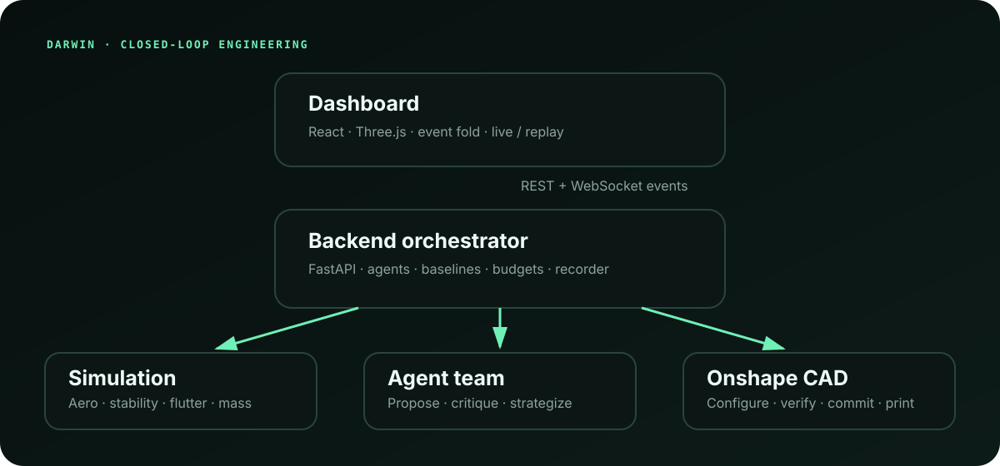

# Darwin

Darwin is an engineering-change prototype for parametric CAD:

`goal -> propose -> simulate -> explain -> review evidence -> approve -> write (only when authorized)`

The implemented reference workflow optimizes a rocket fin against stability,
drag, flutter margin, mass, and landing overhang. Agent roles guide the search;
deterministic code owns the engineering metrics, constraints, and pass/fail
results. The dashboard makes the tradeoff, lineage, budgets, assumptions,
degradations, and winning-design evidence inspectable.



## Current scope

| Capability | Repository status |
|---|---|
| Fin simulation and optimization | Implemented end to end, with agent, CMA-ES, and random-search paths |
| Dashboard and replay | Implemented: live event stream, backend replay, and browser-local fixtures |
| Evidence and human approval | Implemented for the fin: diffs, deterministic requirements, limitations, geometry state, exact design/parameter-hash approval |
| Onshape geometry regeneration | Implemented behind local credentials, with caching, call budgets, and STL sanity checks |
| Onshape write/version | Guarded implementation and tests exist; no successful live write artifact is committed, so this README does not claim a live production write |
| Generic object onboarding and capability reports | Dashboard wizard/report components and fixture tests exist; the production backend and end-to-end integration are not complete, and the real discovery method is still a stub |
| Static-structural domain | Validation spike only; no integrated bracket adapter or end-to-end bracket result |
| Heat sink, physical bracket, Factory Droid, SpacetimeDB | Not claimed by the current build |

Darwin is an optimization and trade-study tool, not a flight-safety or
structural certification system.

## What the dashboard currently shows

- Natural-language goal interpretation with objectives, constraints, and
  assumptions.
- A fixed-topology fin preview that morphs between candidates and can cross-fade
  to returned STL geometry.
- Matched-evaluation-budget agent, CMA-ES, and random-search curves.
- Pareto landscape, evolutionary lineage, and parameter parallel coordinates.
- An agent feed with proposals, critiques, strategy, fallbacks, timing, and
  spend.
- Onshape, model-spend, and evaluation budget meters.
- A winner review with before/after metrics, requirement margins, correction
  sequence, geometry state, approval, and an engineering report.
- Offline replay and fixture-backed kiosk behavior.

The app's existing discovery modal is an earlier prototype. New reviewed-
manifest wizard and capability-report components are present, but component code
alone is not evidence of a live onboarding flow.

## Architecture

The current request path is:

```text
React dashboard
  -> FastAPI REST + WebSocket
  -> budgeted agent loop + CMA-ES/random baselines
  -> scorer registry -> fin_v1 deterministic physics
  -> CAD boundary -> cache/ledger -> Onshape or explicit fallback
  -> ordered JSONL events -> live UI or replay
  -> deterministic evidence -> exact-candidate approval
  -> guarded CAD commit path (disabled unless explicitly configured)
```

The platform direction separates a `ProjectManifest`, `CadAdapter`,
`SolverAdapter`, and versioned domain pack. A new object in a supported domain is
an onboarding problem; a new physics domain still requires an independently
validated solver adapter. The current code has begun that separation through
the scorer registry and CAD boundary, but still contains fin-specific wiring.

## Support maturity contract

The v3 product contract uses explicit authority levels:

| Level | Meaning | Permitted behavior |
|---|---|---|
| 0 — unsupported | CAD/domain cannot be interpreted safely | Explain blockers only |
| 1 — inventory-only | CAD parameters/features can be inspected | Read-only inventory and draft manifest |
| 2 — manifest-reviewed | Engineer approved semantics and required engineering inputs | Read-only probes and planning |
| 3 — solver-ready | A validated adapter accepts the manifest and baseline checks pass | Simulation and bounded optimization |
| 4 — write-enabled | Isolated workspace, recovery plan, and evidence gates are approved | Apply, read back, verify, and create a version |

The registry and capability-report UI that enforce this ladder are planned, not
presented as shipped. Today, the fin is the only end-to-end supported workflow.

## Safety model

- Language models may parse intent, propose search moves, critique, and explain;
  deterministic solvers and requirement code own physical and numeric truth.
- Agent numeric prose is checked against its structured source data.
- CAD regeneration reports ready, failed, skipped, or pending state and does not
  turn a network failure into a success badge.
- Approval binds the selected design ID and parameter hash and is rejected for a
  different candidate.
- Commit is separate from approval and requires explicit write enablement plus
  acknowledgement of an isolated workspace before apply/read-back/geometry
  verification/version creation.
- The evidence report includes assumptions, limitations, degradations, budgets,
  geometry state, and the higher-fidelity result when available.

For generic onboarding, materials, loads, fixtures, contacts, safety factors,
manufacturing process, environment, and acceptance criteria must be sourced or
engineer-confirmed. Missing information must block progress. Imported CAD and
document text will be treated as untrusted data before that flow ships.

## Static-structural scope

[`sim/FEA_SPIKE.md`](sim/FEA_SPIKE.md) records a validation gate for a candidate
`scikit-fem`/Gmsh kernel. The checked cantilever case supports quadratic
tetrahedra and demonstrates why smoothly converging linear tetrahedra can still
be wrong in bending. The repository does **not** yet connect that kernel to a
bracket manifest, mesh/export pipeline, structural adapter, protected-interface
checks, or an optimized bracket run. It is solver R&D, not a shipped second
domain or FEA-backed product claim.

## Quick start

Use Python 3.9 and Node 20.19 or newer.

```bash
python -m venv .venv
source .venv/bin/activate
pip install -r requirements.txt

cd dashboard
npm ci
```

From the repository root, start the deterministic fixture server:

```bash
make mock
```

In a second terminal:

```bash
cd dashboard
npm run dev
```

Open [http://localhost:5173](http://localhost:5173). The mock server streams
`shared/fixtures/sample_run.jsonl` and serves cached fixture STLs, so this path
requires no credentials or network.

For the real backend, source local secrets outside the repository, configure the
`DARWIN_*` variables documented in [`.env.example`](.env.example), and use
`make dev`. Real mode may fall back when a selected component is unavailable;
inspect `/api/health` and the dashboard degradation labels before making a live
claim.

## Verification

The root suite is pinned to Python 3.9:

```bash
make contracts
make test
make secrets-check

cd dashboard
npm test
npm run build
npm audit
```

The FEA spike has optional dependencies and a separate reproduction command in
[`sim/FEA_SPIKE.md`](sim/FEA_SPIKE.md).

## Path to production

Phase 4 adds a versioned engineering-knowledge layer: cited domain packs,
approved project documents, applicability metadata, conflict reporting,
prompt-injection defenses, and evaluation on a reviewed corpus.

Phase 5 adds durable/resumable jobs, sandboxed solvers, reproducible artifacts,
role-based access, tenant isolation, encrypted secrets, audit and retention
controls, transactional CAD recovery, concurrent-edit protection, and cost caps
for CAD, compute, storage, and model usage. New domains enter only through
adapter reference suites; another CAD provider waits until Onshape onboarding
is reliable.

## Repository map

- [`shared/`](shared/) — Python/TypeScript contracts, events, fixtures, and
  fakes.
- [`sim/`](sim/) — deterministic fin physics, scoring, Pareto/sensitivity tools,
  and the structural FEA spike.
- [`backend/`](backend/) — FastAPI orchestration, agent roles, baselines,
  recording/replay, approvals, and evidence reports.
- [`cad/`](cad/) — Onshape boundary, cache, call ledger, geometry validation,
  and guarded persistence path.
- [`dashboard/`](dashboard/) — React/TypeScript mission-control interface.
- [`docs/pitch.md`](docs/pitch.md) — status-gated two-minute pitch, maturity
  ladder, and sponsor variants.
- [`docs/devpost.md`](docs/devpost.md) — evidence-bounded submission draft.
- [`docs/demo-script.md`](docs/demo-script.md) — demo and fallback-video script.

## Responsible disclosure of scope

The fin model assumes subsonic, low-incidence flow, a rigid body, isotropic
solid PLA, and a fixed reference rocket. Its flutter result is a screening
estimate; its higher-fidelity result is an aerodynamic cross-check, not CFD,
structural FEA, OpenRocket validation, or certification. See
[`sim/PHYSICS.md`](sim/PHYSICS.md).

No credentials, Onshape document IDs, or production recordings belong in Git.
Run `make secrets-check` before sharing or submitting.
